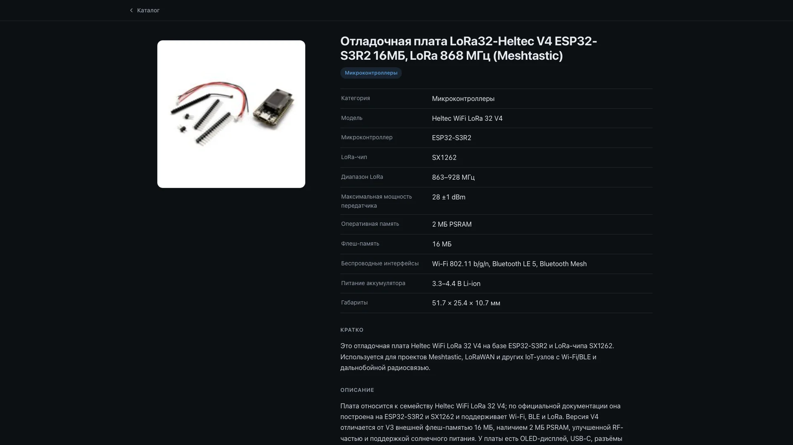

# Завхоз — каталог электроники

**Открытый справочник деталей личного склада: фото, характеристики и ссылки на официальную документацию**

[Открыть каталог](https://azbezd.github.io/zavhoz-web/)

## Что это

Статический сайт: каталог по категориям с поиском и отдельная страница на каждую деталь — фото, характеристики, краткое описание, ссылки на даташиты производителя. Количество, цены и применение в проектах сюда не попадают: они остаются в приватной базе.

## Откуда берётся

Сайт генерирует [zavhoz-bot](https://github.com/azbezd/zavhoz-bot) из базы склада (`inventory_bot/build_site.py`) и пересобирает при её изменении. Это репозиторий сборки, а не исходников: ручные правки здесь перезапишутся. Вид меняется в генераторе, содержимое — через бота.

## Устройство

| Путь | Что |
|---|---|
| `index.html` | каталог по категориям и поиск |
| `item/<id>.html` | страница позиции; адрес постоянный — на него ведут ссылки из бота |
| `photos/` | локальные копии фото, чтобы страницы не зависели от магазинов |
| `assets/style.css` | вся вёрстка: тёмная тема, системные шрифты, без внешних зависимостей |
| `404.html` | страница «не найдено» |
